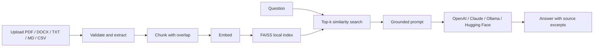

# RAG-Based Document Q&A Chatbot

A local-first Retrieval-Augmented Generation (RAG) application that lets you upload documents and ask natural-language questions grounded in retrieved passages. Built with Python, Streamlit, LangChain, FAISS, Hugging Face embeddings, and provider-agnostic LLM integration.

**Target GitHub repository:** [Prajjaval08/rag-document-qa-chatbot](https://github.com/Prajjaval08/rag-document-qa-chatbot) — publish this local project using [`docs/GITHUB_SETUP.md`](docs/GITHUB_SETUP.md).  
**Status:** Local build (not published to GitHub); the repository link below is the intended publishing target only — verify it after a manual push, and review the privacy limitations before using private documents.

## Features

- **Multiple document formats:** PDF, DOCX, TXT, Markdown, and CSV, plus webpages via URL (HTML stripped to text; JavaScript-rendered pages are not supported).
- **RAG pipeline:** file parsing, overlapping chunking (1000 chars / 150 overlap by default), embeddings, FAISS similarity search, grounded generation, and source excerpts.
- **Provider-agnostic generation:** OpenAI, Anthropic Claude, Ollama (local), Hugging Face Inference API, and Google Gemini (free AI Studio key, no credit card on the free tier).
- **Embeddings:** local Sentence Transformers (`all-MiniLM-L6-v2`) by default; optional OpenAI embeddings or local Ollama embeddings (`nomic-embed-text`).
- **Evaluation:** retrieval recall / hit rate, answer-keyword coverage, and latency via `scripts/evaluate.py` and `docs/evaluation.md`.
- **Automation:** directory-watch / scheduled re-index via `scripts/watch_and_reindex.py` (see `docs/automation.md`) — invoke it from cron, Task Scheduler, or any connector job; no vendor connector is claimed to be connected.
- **Persistence:** local FAISS index and manifest survive Streamlit restarts.
- **Duplicate protection:** SHA-256 hashes prevent re-indexing identical file contents.
- **Source attribution:** filename, PDF page where available, chunk ID, and a readable excerpt.
- **Safety-minded prompting:** retrieved document text is treated as untrusted data; unsupported answers should be acknowledged instead of invented.
- **Quality and delivery:** unit tests, GitHub Actions CI, Docker, and step-by-step docs.

## Architecture



See [`docs/architecture.md`](docs/architecture.md) for component boundaries and persistence details.

## Requirements

- Python 3.11 or 3.12 recommended.
- Git.
- One generation backend: an API key for OpenAI/Anthropic/Hugging Face Inference, or Ollama with a downloaded chat model.
- Enough memory and disk space for the local Sentence Transformers embedding model. Its weights are downloaded on first use.

## Quick start — Windows PowerShell

```powershell
py -3.11 -m venv .venv
.\.venv\Scripts\Activate.ps1
python -m pip install --upgrade pip
pip install -r requirements.txt
Copy-Item .env.example .env
```

Open `.env` in an editor and configure one provider. For the easiest no-hosted-key setup, install Ollama separately, run `ollama pull llama3.2`, keep `LLM_PROVIDER=ollama`, and make sure Ollama is running.

Then launch:

```powershell
streamlit run app.py
```

Streamlit prints a local URL, usually `http://localhost:8501`. Upload documents and click **Index documents** before asking your first question.

If PowerShell does not allow virtual environment activation, use the environment's Python directly:

```powershell
.\.venv\Scripts\python.exe -m pip install -r requirements.txt
.\.venv\Scripts\python.exe -m streamlit run app.py
```

## Quick start — macOS/Linux

```bash
python3.11 -m venv .venv
source .venv/bin/activate
python -m pip install --upgrade pip
pip install -r requirements.txt
cp .env.example .env
# Edit .env and configure the desired provider.
streamlit run app.py
```

## Configuration

Copy `.env.example` to `.env`. Never commit `.env` or paste its secret values into chat, README, or source files.

| Variable | Purpose | Default |
|---|---|---|
| `LLM_PROVIDER` | `openai`, `anthropic`, `ollama`, `huggingface`, or `gemini` | `ollama` |
| `LLM_MODEL` | Chat model ID/name for the selected provider | `llama3.2` (or `gemini-3.8-flash` with `gemini`) |
| `LLM_TEMPERATURE` | Generation temperature | `0.1` |
| `RETRIEVAL_TOP_K` | Number of chunks to retrieve | `4` |
| `EMBEDDING_PROVIDER` | `local`, `openai`, or `ollama` | `local` |
| `EMBEDDING_MODEL` | Hugging Face embedding model | `sentence-transformers/all-MiniLM-L6-v2` |
| `OPENAI_EMBEDDING_MODEL` | Model used for optional OpenAI embeddings | `text-embedding-3-small` |
| `OLLAMA_EMBEDDING_MODEL` | Model used for optional Ollama embeddings (pull first: `ollama pull nomic-embed-text`) | `nomic-embed-text` |
| `CHUNK_SIZE` | Approximate characters per chunk | `1000` |
| `CHUNK_OVERLAP` | Characters carried between chunks | `150` |
| `MAX_UPLOAD_MB` | Maximum size per file | `20` |
| `OLLAMA_BASE_URL` | Ollama endpoint | `http://localhost:11434` |

The sidebar allows provider, model, embedding, temperature, and retrieval changes at runtime. If the embedding provider/model changes, clear the existing index and re-index all desired documents. Generation-provider changes alone do not require rebuilding the vector index.

### Provider setup

**OpenAI**

Set `LLM_PROVIDER=openai`, choose a model available to your account (the UI defaults to `gpt-4o-mini`), and configure `OPENAI_API_KEY`. If using OpenAI embeddings too, set `EMBEDDING_PROVIDER=openai`.

**Anthropic Claude**

Set `LLM_PROVIDER=anthropic`, configure `ANTHROPIC_API_KEY`, and choose an available model (the UI default is `claude-haiku-4-5-20251001`; replace it if that model alias is not available to your account).

**Ollama local**

Install Ollama separately, start its local service, and download a chat model, for example `ollama pull llama3.2`. Set `LLM_PROVIDER=ollama` and `OLLAMA_BASE_URL` if required. Local generation does not send prompt content to a hosted LLM provider, but the default Hugging Face embedding model may download model files the first time.

**Hugging Face Inference API**

Set `LLM_PROVIDER=huggingface`, `HUGGINGFACEHUB_API_TOKEN`, and a supported text-generation model repository ID. Availability depends on the current Hugging Face Inference service and your token permissions.

**Google Gemini (free key, no paid key needed)**

Get a free key at Google AI Studio (aistudio.google.com → Get API key → Create API key, no credit card on the free tier, rate-limited). Set `LLM_PROVIDER=gemini`, `LLM_MODEL=gemini-3.8-flash`, and `GEMINI_API_KEY` (`GOOGLE_API_KEY` is also accepted). For Streamlit Cloud, use this with `EMBEDDING_PROVIDER=local` so embeddings need no second key — see `docs/deploy.md`.

## How it works

1. **Load:** files are read from memory. PDF pages are retained separately where text can be extracted; DOCX paragraphs and tables are converted to text; TXT/MD/CSV are decoded into readable text.
2. **Chunk:** `RecursiveCharacterTextSplitter` creates chunks with overlap to preserve context near boundaries.
3. **Embed:** each chunk is transformed into a vector by the selected embedding backend.
4. **Index:** FAISS performs similarity search. The index and a manifest are stored under `data/faiss_index/`.
5. **Retrieve:** a user question is embedded in the same vector space and the top-k chunks are selected.
6. **Generate:** the selected LLM receives the question and retrieved excerpts under a grounding instruction.
7. **Cite:** the UI shows the source filename, page when available, chunk ID and a preview excerpt.

The system is not guaranteed to be correct. Inspect the citations and source excerpts before relying on an answer.

## Tests and linting

```bash
pip install -r requirements-test.txt
pytest
python -m pip install "ruff>=0.8,<1.0"
ruff check .
```

The test dependency set avoids provider SDKs and model weights; it still needs the listed Python packages available from your package index. Tests do not call paid APIs. GitHub Actions runs the suite on Python 3.11 and 3.12. For the full UI and provider backends, install `requirements.txt` (or `requirements-dev.txt`).

## Deploying live

Yes, it can go live — see [`docs/deploy.md`](docs/deploy.md) for the
two free routes (Streamlit Community Cloud, easiest, and Render via
`render.yaml`), including the secrets setup and the live caveats:
Ollama does not work hosted (use Gemini / OpenAI / Anthropic / Hugging Face),
the FAISS index resets on free-tier restarts, and there is no login,
so do not share a live link publicly with your API key attached.

## Docker

Create `.env` from `.env.example`, configure a reachable LLM endpoint, then run:

```bash
docker compose up --build
```

Open `http://localhost:8501`. The `data/` folder is mounted for persistence. If Ollama runs on the host, `localhost` inside the app container does not usually refer to the host; configure a host-reachable address or put both services on a Docker network.

## Repository structure

```text
app.py                         Streamlit UI
src/rag_chatbot/config.py      Environment configuration
src/rag_chatbot/loaders.py     Safe, in-memory file parsers
src/rag_chatbot/chunking.py    Chunking and metadata preservation
src/rag_chatbot/embeddings.py  Embedding provider factory
src/rag_chatbot/vector_store.py FAISS persistence and deduplication
src/rag_chatbot/llm.py         Chat provider factory
src/rag_chatbot/rag.py         Retrieval, grounded answer, source formatting
tests/                         Unit tests
.github/workflows/ci.yml       CI pipeline
docs/                          Architecture, implementation plan, setup, troubleshooting and maintenance guides
```

## Security and privacy

- `.env`, local vector indexes, user uploads, virtual environments and caches are excluded by `.gitignore`.
- Uploaded originals are parsed in memory and not explicitly copied to disk. Extracted text chunks and metadata are persisted in the local FAISS index, which can contain sensitive information.
- If using OpenAI, Anthropic, or Hugging Face-hosted generation, the question and retrieved excerpts are sent to that provider. Review its data-handling terms before uploading confidential content.
- FAISS persistence includes a local pickle file. Only load indexes generated by this app in your trusted local directory; never load an index supplied by an untrusted person.
- The project is a local single-user portfolio app. It does not implement authentication, multi-tenant isolation, per-user document authorization, audit logs, or document-level deletion.
- Scanned PDFs need OCR; OCR is not currently included.

## Troubleshooting

See [`docs/troubleshooting.md`](docs/troubleshooting.md) for common installation, provider, FAISS, and retrieval issues. The detailed setup walkthrough is in [`docs/step-by-step.md`](docs/step-by-step.md), and ongoing change/release checks are in [`docs/maintenance.md`](docs/maintenance.md).

## Roadmap

- Streaming answers and richer conversation controls.
- OCR support for scanned documents.
- Optional reranking and hybrid keyword/vector retrieval.
- Per-document delete/re-index and index inspection tools.
- API layer and authentication for multi-user deployment.
- Chunk-level (not just file-level) retrieval evaluation and citation-correctness checks — the current eval set measures file-level recall and keyword coverage only.

## GitHub publishing

The intended repository is [`Prajjaval08/rag-document-qa-chatbot`](https://github.com/Prajjaval08/rag-document-qa-chatbot). See [`docs/GITHUB_SETUP.md`](docs/GITHUB_SETUP.md) for verified push steps. Do not claim code is online until a push succeeds.

## License

MIT — see [`LICENSE`](LICENSE).
