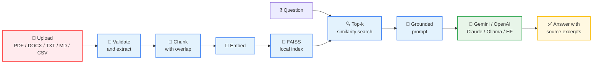

<div align="center">

# 📄 RAG Document Q&A Chatbot

### 💬 Upload your documents. Ask anything. Get answers grounded in *your* files — with sources.

[](https://chatbot-prajjaval.streamlit.app/)
[](https://www.python.org/)
[](https://streamlit.io/)
[](https://github.com/facebookresearch/faiss)
[](https://aistudio.google.com/)
[](https://github.com/Prajjaval08/RAG-DOCUMNET-QA-CHATBOT/actions)
[](LICENSE)

**🎉 Live & verified:** [chatbot-prajjaval.streamlit.app](https://chatbot-prajjaval.streamlit.app/)
**💻 Repository:** [Prajjaval08/RAG-DOCUMNET-QA-CHATBOT](https://github.com/Prajjaval08/RAG-DOCUMNET-QA-CHATBOT)

> ✨ **No invented answers.** If the documents don't contain it, the bot says so — and shows you exactly which chunk it used when they do.

</div>

---

## 🎬 Live demo — it actually works

Ask a grounded question about an uploaded resume, and you get this kind of answer:

> **Q:** What is the CGPA and degree mentioned in the resume?
>
> **A:** CGPA: **9.03/10** · Degree: **B.Tech in Computer Science and Engineering**
>
> **📎 Sources:** `NORMAL_RESUME.pdf`, page 1 — chunks `77651a0390d6-0000`, `0001`, `0002`, `0004`

✅ Retrieval · ✅ Grounded generation · ✅ Source attribution · ✅ Conversation history

---

## ✨ Features

| 🎯 Feature | 💡 What you get |
|---|---|
| 📚 **Many formats** | PDF, DOCX, TXT, Markdown, CSV — plus webpages via URL (HTML stripped to text; JavaScript-rendered pages are not supported) |
| 🧩 **Smart chunking** | Overlapping chunks — **1000 chars / 150 overlap** by default — so context survives chunk boundaries |
| 🔍 **RAG pipeline** | Parse → chunk → embed → FAISS search → grounded generation → cited answer |
| 🤖 **Any LLM you like** | OpenAI, Anthropic Claude, Ollama (local), Hugging Face, **and Google Gemini (free AI Studio key)** |
| 🧠 **Local embeddings** | Sentence Transformers (`all-MiniLM-L6-v2`) by default; optional OpenAI or Ollama (`nomic-embed-text`) embeddings |
| 🛡️ **Duplicate protection** | SHA-256 hashes stop identical files being indexed twice |
| 📎 **Source attribution** | Filename, PDF page, chunk ID, and a readable excerpt for every answer |
| 🧪 **Evaluation** | Retrieval recall / hit rate, answer-keyword coverage, and latency via `scripts/evaluate.py` |
| 🔄 **Automation** | Directory-watch / scheduled re-index via `scripts/watch_and_reindex.py` — cron, Task Scheduler, or any connector job |
| 💾 **Persistence** | Local FAISS index + manifest survive local restarts *(on Streamlit Cloud free tier, the index resets on restart — re-upload then)* |
| 🧠 **Safety-first prompting** | Retrieved text is treated as **untrusted data** — unsupported answers are acknowledged, not invented |
| ✅ **Quality** | 55 unit tests, GitHub Actions CI, Docker, and step-by-step docs |

---

## 🗺️ Architecture



See [`docs/architecture.md`](docs/architecture.md) for component boundaries and persistence details.

---

## 🚀 Quick start

### 🪟 Windows PowerShell

```powershell
py -3.11 -m venv .venv
.\.venv\Scripts\Activate.ps1
python -m pip install --upgrade pip
pip install -r requirements.txt
Copy-Item .env.example .env
```

Open `.env` in an editor and configure one provider. For the easiest no-hosted-key setup, install Ollama separately, run `ollama pull llama3.2`, keep `LLM_PROVIDER=ollama`, and make sure Ollama is running.

Then launch:

```powershell
streamlit run app.py
```

Streamlit prints a local URL, usually `http://localhost:8501`. Upload documents and click **Index documents** before asking your first question.

If PowerShell does not allow virtual environment activation, use the environment's Python directly:

```powershell
.\.venv\Scripts\python.exe -m pip install -r requirements.txt
.\.venv\Scripts\python.exe -m streamlit run app.py
```

### 🍎🐧 macOS / Linux

```bash
python3.11 -m venv .venv
source .venv/bin/activate
python -m pip install --upgrade pip
pip install -r requirements.txt
cp .env.example .env
# Edit .env and configure the desired provider.
streamlit run app.py
```

---

## ⚙️ Configuration

Copy `.env.example` to `.env`. **Never commit `.env` or paste its secret values into chat, README, or source files.**

| Variable | Purpose | Default |
|---|---|---|
| `LLM_PROVIDER` | `openai`, `anthropic`, `ollama`, `huggingface`, or `gemini` | `ollama` |
| `LLM_MODEL` | Chat model ID/name for the selected provider | `llama3.2` (or `gemini-3.8-flash` with `gemini`) |
| `LLM_TEMPERATURE` | Generation temperature | `0.1` |
| `RETRIEVAL_TOP_K` | Number of chunks to retrieve | `4` |
| `EMBEDDING_PROVIDER` | `local`, `openai`, or `ollama` | `local` |
| `EMBEDDING_MODEL` | Hugging Face embedding model | `sentence-transformers/all-MiniLM-L6-v2` |
| `OPENAI_EMBEDDING_MODEL` | Model used for optional OpenAI embeddings | `text-embedding-3-small` |
| `OLLAMA_EMBEDDING_MODEL` | Model used for optional Ollama embeddings (pull first: `ollama pull nomic-embed-text`) | `nomic-embed-text` |
| `CHUNK_SIZE` | Approximate characters per chunk | `1000` |
| `CHUNK_OVERLAP` | Characters carried between chunks | `150` |
| `MAX_UPLOAD_MB` | Maximum size per file | `20` |
| `OLLAMA_BASE_URL` | Ollama endpoint | `http://localhost:11434` |

The sidebar allows provider, model, embedding, temperature, and retrieval changes at runtime. If the embedding provider/model changes, clear the existing index and re-index all desired documents. Generation-provider changes alone do not require rebuilding the vector index.

### 🔑 Provider setup

<details>
<summary><b>🌟 Google Gemini — free key, recommended for Cloud</b></summary>

Get a free key at Google AI Studio (aistudio.google.com → Get API key → Create API key, no credit card on the free tier, rate-limited). Set `LLM_PROVIDER=gemini`, `LLM_MODEL=gemini-3.8-flash`, and `GEMINI_API_KEY` (`GOOGLE_API_KEY` is also accepted). For Streamlit Cloud, use this with `EMBEDDING_PROVIDER=local` so embeddings need no second key — see `docs/deploy.md`.

> 💡 Gemini free tier can occasionally return `503 — high demand`. The app now retries once on 429/503 and once on timeouts, and caps answers at 512 tokens to keep replies fast.

</details>

<details>
<summary><b>🤖 OpenAI</b></summary>

Set `LLM_PROVIDER=openai`, choose a model available to your account (the UI defaults to `gpt-4o-mini`), and configure `OPENAI_API_KEY`. If using OpenAI embeddings too, set `EMBEDDING_PROVIDER=openai`.

</details>

<details>
<summary><b>🟣 Anthropic Claude</b></summary>

Set `LLM_PROVIDER=anthropic`, configure `ANTHROPIC_API_KEY`, and choose an available model (the UI default is `claude-haiku-4-5-20251001`; replace it if that model alias is not available to your account).

</details>

<details>
<summary><b>🏠 Ollama — fully local</b></summary>

Install Ollama separately, start its local service, and download a chat model, for example `ollama pull llama3.2`. Set `LLM_PROVIDER=ollama` and `OLLAMA_BASE_URL` if required. Local generation does not send prompt content to a hosted LLM provider, but the default Hugging Face embedding model may download model files the first time.

</details>

<details>
<summary><b>🤗 Hugging Face Inference API</b></summary>

Set `LLM_PROVIDER=huggingface`, `HUGGINGFACEHUB_API_TOKEN`, and a supported text-generation model repository ID. Availability depends on the current Hugging Face Inference service and your token permissions.

</details>

---

## 🧠 How it works

1. **📥 Load:** files are read from memory. PDF pages are retained separately where text can be extracted; DOCX paragraphs and tables are converted to text; TXT/MD/CSV are decoded into readable text.
2. **🧩 Chunk:** `RecursiveCharacterTextSplitter` creates chunks with overlap to preserve context near boundaries.
3. **🧠 Embed:** each chunk is transformed into a vector by the selected embedding backend.
4. **💾 Index:** FAISS performs similarity search. The index and a manifest are stored under `data/faiss_index/`.
5. **🔍 Retrieve:** a user question is embedded in the same vector space and the top-k chunks are selected.
6. **🤖 Generate:** the selected LLM receives the question and retrieved excerpts under a grounding instruction.
7. **📎 Cite:** the UI shows the source filename, page when available, chunk ID and a preview excerpt.

> ⚠️ The system is not guaranteed to be correct. Inspect the citations and source excerpts before relying on an answer.

---

## 🧪 Tests and linting

```bash
pip install -r requirements-test.txt
pytest
python -m pip install "ruff>=0.8,<1.0"
ruff check .
```

✅ **55 tests passing** — the test dependency set avoids provider SDKs and model weights; it still needs the listed Python packages available from your package index. Tests do not call paid APIs. GitHub Actions runs the suite on Python 3.11 and 3.12. For the full UI and provider backends, install `requirements.txt` (or `requirements-dev.txt`).

---

## ☁️ Deploying live

Yes, it can go live — and it is live! 🎉 See [`docs/deploy.md`](docs/deploy.md) for the two free routes (Streamlit Community Cloud, easiest, and Render via `render.yaml`), including the secrets setup and the live caveats:
Ollama does not work hosted (use Gemini / OpenAI / Anthropic / Hugging Face),
the FAISS index resets on free-tier restarts, and there is no login,
so do not share a live link publicly with your API key attached.

---

## 🐳 Docker

Create `.env` from `.env.example`, configure a reachable LLM endpoint, then run:

```bash
docker compose up --build
```

Open `http://localhost:8501`. The `data/` folder is mounted for persistence. If Ollama runs on the host, `localhost` inside the app container does not usually refer to the host; configure a host-reachable address or put both services on a Docker network.

---

## 📁 Repository structure

```text
app.py                         Streamlit UI
src/rag_chatbot/config.py      Environment configuration
src/rag_chatbot/loaders.py     Safe, in-memory file parsers
src/rag_chatbot/chunking.py    Chunking and metadata preservation
src/rag_chatbot/embeddings.py  Embedding provider factory
src/rag_chatbot/vector_store.py FAISS persistence and deduplication
src/rag_chatbot/llm.py         Chat provider factory
src/rag_chatbot/rag.py         Retrieval, grounded answer, source formatting
tests/                         Unit tests
.github/workflows/ci.yml       CI pipeline
docs/                          Architecture, implementation plan, setup, troubleshooting and maintenance guides
```

---

## 🔒 Security and privacy

- `.env`, local vector indexes, user uploads, virtual environments and caches are excluded by `.gitignore`.
- Uploaded originals are parsed in memory and not explicitly copied to disk. Extracted text chunks and metadata are persisted in the local FAISS index, which can contain sensitive information.
- If using OpenAI, Anthropic, or Hugging Face-hosted generation, the question and retrieved excerpts are sent to that provider. Review its data-handling terms before uploading confidential content.
- FAISS persistence includes a local pickle file. Only load indexes generated by this app in your trusted local directory; never load an index supplied by an untrusted person.
- The project is a local single-user portfolio app. It does not implement authentication, multi-tenant isolation, per-user document authorization, audit logs, or document-level deletion.
- Scanned PDFs need OCR; OCR is not currently included.

---

## 🛠️ Troubleshooting

See [`docs/troubleshooting.md`](docs/troubleshooting.md) for common installation, provider, FAISS, and retrieval issues. The detailed setup walkthrough is in [`docs/step-by-step.md`](docs/step-by-step.md), and ongoing change/release checks are in [`docs/maintenance.md`](docs/maintenance.md).

## 🗺️ Roadmap

- 🚀 Streaming answers and richer conversation controls
- 🔍 OCR support for scanned documents
- 🎯 Optional reranking and hybrid keyword/vector retrieval
- 🗑️ Per-document delete/re-index and index inspection tools
- 🔐 API layer and authentication for multi-user deployment
- 📊 Chunk-level (not just file-level) retrieval evaluation and citation-correctness checks — the current eval set measures file-level recall and keyword coverage only

---

<div align="center">

### ⭐ If you like this project, star it on GitHub!

**Built with ❤️ by [Prajjaval Pandey](https://github.com/Prajjaval08) · MIT License — see [`LICENSE`](LICENSE)**

</div>
